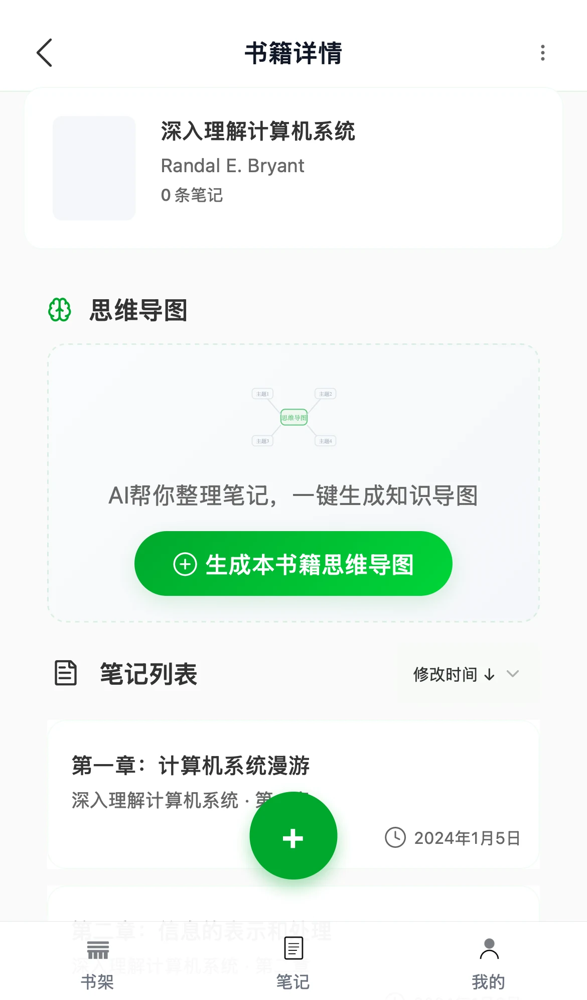
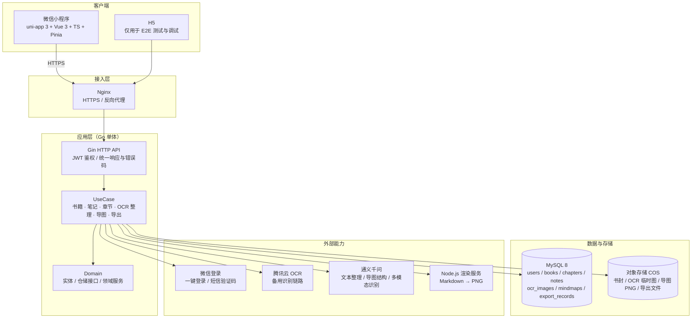

# 阅记（Yueji）：把纸质书划线笔记变成可复习的知识结构（MVP 产品档案）

> **项目卡片** · 独立 0→1 · 2025.08–2026 上半年（已阶段性中止）· 角色：独立产品 + 全栈实现 + 测试与上线 · 技术栈：uni-app 3 · Vue 3 · TypeScript · Pinia · Go + Gin + GORM · MySQL 8 · 腾讯云 COS · 微信 OCR / 通义千问 · 形态：微信小程序（H5 仅用于测试）

> 一句话：阅记是一个"拍照或框选书里的划线句 → OCR 识别 → 按章节整理成可复习的结构化笔记 → 自动生成思维导图 → 导出到常用工具"的微信小程序。本仓库记录它的产品设计、架构选型、关键取舍、测试证据，以及一个人从 0 到上线内测、再到主动停掉的完整判断过程。

**给读者的话**：这个项目已经停了。它值得看的地方不是"功能多"，而是三件事：**我如何在 30 多条需求里只留下 4 个核心功能**、**我如何在 OCR + AI 这种不稳定链路上做降级与兜底**、以及**我在什么信号下判断这件事不值得继续做**。仓库里的数字都注明来源或样本边界；没有验证过的，我会写"没有验证"。

- 作品集单页（本项目）：[https://zhaolijian.github.io/cases/yueji.html](https://zhaolijian.github.io/cases/yueji.html)

---

## 1. 项目背景

### 1.1 问题：纸质书的笔记，记得下但用不起来

读纸质书的人通常有两种笔记：**划线**（捕捉重点）和**摘抄**（二次加工）。但这两步之后往往没有第三步——笔记散落在纸页或相册里，没有结构、不能检索，复习时也找不到上下文。我把问题拆成三个具体断点：

- **录入成本高**：手抄划线句太慢，拍照后逐条整理更麻烦；
- **结构缺失**：划线句是碎片，不知道属于哪一章、在书里的什么位置，复习时失去线索；
- **无法迁移**：整理好的笔记留在某个 App 里，进不了用户已有的笔记体系。

真正缺的不是"记录工具"，而是**把划线句变成可复习的知识结构**的那一步。

### 1.2 我的解法：一条从照片到结构的单点闭环

产品不试图做"通用笔记工具"，只做一件事：把纸质书上的划线句变成有章节位置、有逻辑结构的电子笔记，再生成可回顾的思维导图。核心链路只有五步：

```
拍照 / 框选划线 → OCR 识别 → 按章节结构化 → 生成思维导图 → 导出（规划中：导入）
```



### 1.3 目标用户（当时写的画像，标注为假设）

- **知识型职场人**：每月读 2–3 本专业书，习惯在书上划线，需要通勤时快速回顾；
- **备考学生**：教材和参考书大量标注，需要靠思维导图串联知识点、打印复习资料；
- **重度读者 / 写作者**：笔记积累多年但缺乏整理，写作时需要按主题检索素材。

这三个画像来自**竞品使用观察 + 自身阅读习惯的归纳，不是正式用户访谈的产物**。这是当时研究方法的真实边界，也是后来我判断"价值假设没有被验证"的原因之一（见 [docs/02](./docs/02-research-and-decision.md)）。

---

## 2. 我的角色

我是这个项目的**唯一执行者**，没有团队、没有外包：

- **产品**：40+ 款笔记 / 阅读类产品的竞品调研、用户画像与场景、PRD（`docs/01`）、原型与交互、MVP 范围定义、验收标准；
- **设计系统**：设计令牌、页面级令牌、通用组件（`docs/04`），把 Figma 视觉稿逐步落到 uni-app 页面；
- **工程**：uni-app + Vue 3 + TypeScript 前端、Go + Gin + GORM 后端、MySQL 数据模型、COS 对象存储、OCR 与通义千问接入、思维导图渲染链路（`docs/03`）；
- **测试与上线**：后端 TDD 与集成测试、前端 Vitest + Playwright（含视觉回归）、微信开发者工具与真机验证、小程序提审上线（`docs/05`）；
- **复盘**：竞品与我方能力对照、价值假设复核、止损判断（`docs/02`）。

我更愿意把这段经历定义成"**一个人的 0→1**"：它证明我能独立把产品做到上线，也证明我能在"做完了"和"值得继续做"之间做出区分。

---

## 3. 关键决策（每条：背景 → 取舍 → 结论 → 代价）

完整论证见 `docs/` 各篇，这里只放结论与代价。

### 决策一：MVP 只做 4 个核心功能，30+ 条需求被推后或砍掉

- **背景**：原始需求列表有 30 多条（社交分享、多端同步、数据分析、标签体系、自定义主题、协作批注……），每条看起来都"顺手就能做"。
- **取舍**：功能完整度 vs 验证速度。当时真正要验证的不是"能不能做出来"，而是"纸质书用户会不会为了结构化笔记改变现有习惯"。
- **结论**：按"是否支撑核心闭环"收敛为 4 个功能：**①书籍与笔记管理 ②拍照识别与结构化整理 ③阅读与编辑（含导出）④思维导图生成**；社交、多端同步、数据分析、付费全部列入"不做清单"。
- **代价**：产品看起来"薄"，缺少让用户眼前一亮的增长功能；竞品对比表里能对上的差异化点也更少。详见 [docs/01](./docs/01-prd.md)。

### 决策二：前端从原生小程序迁到 uni-app + Vue 3 + TypeScript

- **背景**：最初按原生微信小程序起步，开发中发现两个诉求：一是 H5 要做自动化测试与快速调试，二是长期想覆盖 App 与其他小程序平台。
- **取舍**：原生性能与官方支持 vs 一码多端与开发效率。选 uni-app 意味着接受 5%–10% 的性能损耗、以及大量原生 API 的适配工作。
- **结论**：迁移到 uni-app + Vue 3 + TS + Pinia + uView Plus，用条件编译处理小程序与 H5 差异，H5 作为 E2E 测试宿主。
- **代价**：重写了一次前端；依赖版本被 uni-app 生态锁定（Vue 版本、编译链）；**多端能力最后只落地了微信小程序 + H5，App 端只留了配置**——多端是想清楚的方向，但不是这个阶段兑现的价值。

### 决策三：OCR 与 AI 整理做了两代方案，第二代用"直传 + 多模态 LLM"换精度

- **背景**：第一代采用「前端微信 OCR 插件识别 → 后端通义千问合并整理」。好处是免费、图片不出端；问题是识别精度受插件限制、切行与分段质量差，而且识别和整理是两段，错误会叠加。第一代还依赖平台插件，多端扩展受限。
- **取舍**：免费与隐私（端内识别，图片不上传）vs 精度与结构化质量（图片上传到对象存储，由多模态模型一次完成识别 + 整理）。
- **结论**：保留 OCR 备用链路（腾讯云 OCR），主链路改为「预签名 URL 直传 COS → 服务端调用多模态 LLM 识别并结构化 → SSE 流式返回 → 前端插入笔记并高亮」；同时做失败降级（识别失败可转手动输入）。
- **代价**：图片进入云端，隐私承诺的口径必须从"图片不出端"改成"图片写入临时目录、可删除、仅用于识别"；**每次整理都有模型成本与 3 秒以上的等待**，弱网下体验明显变差；LLM 输出不可控，需要 HTML 白名单净化与兜底（见 [docs/03](./docs/03-architecture.md)）。

### 决策四：架构做减法——单体、无业务缓存、软删除、JWT

- **背景**：一个人维护，运维成本是硬约束；MVP 预期日活很低，引入 Redis 缓存 / 微服务 / 消息队列都是纯粹的复杂度。
- **取舍**：性能上限与扩展性 vs 迭代速度与可调试性。用 MySQL 直连 + 单进程 + 无状态 JWT 足够支撑内测规模。
- **结论**：单体 Go 服务（接口层 / UseCase / Domain / Infrastructure 四层），不做业务数据缓存（短信验证码的限流计数是唯一用到 Redis 的地方），笔记采用软删除、书籍删除做前置校验后物理删除，登录用 JWT（7 天）无状态校验。
- **代价**：接口响应比带缓存方案多 20–50ms；笔记软删除让查询必须带过滤条件、数据只增不减；没有缓存层意味着未来要高并发时必须补（当日活超过 5000 时重新评估——这是当时写在 ADR 里的触发条件）。

### 决策五：先体验后登录，登录态用"二元状态 + 401 兜底"

- **背景**：早期打开小程序即被强制跳转登录页，用户没看到产品就先被要授权，首次体验被破坏；登录页 UI 也和"我的"页面风格割裂。
- **取舍**：严格的登录态校验（安全、状态明确）vs 先体验后登录（转化优先，但本地 token 可能过期）。
- **结论**：采用二元登录态（本地有 token 即视为已登录，不做启动时网络校验），在需要登录的操作入口统一挂 `ensureLoggedIn` 守卫；401/403 时自动清 token 并跳登录；同时把登录页重做成与设计系统一致的卡片式布局。
- **代价**：本地 token 过期时，用户会先看到一次失败提示再被引导登录；网络错误与鉴权错误必须严格区分，否则会出现"断网被登出"的体验事故。

### 决策六：停掉项目——价值假设被平台能力抹平

- **背景**：MVP 上线并完成小范围内测后，复盘时对比同期的通用工具：Notion 已能做 OCR 识别、智能整理与 AI 辅助；Manus 这类 Agent 产品可以把"识别 → 整理 → 导图"串起来；笔记产品加 OCR 与思维导图的技术门槛正在快速下降。
- **取舍**：继续打磨体验（沉没成本已经投入，功能也确实还能做得更好）vs 承认差异化不可持续、及时止损。
- **结论**：主动停止迭代。我的差异化会被平台能力持续抹平，而用户迁移成本极低——**没有理由为了"更好的体验"换工具**。
- **代价**：承认前期投入不再产生复利；放弃了一个"完成度看起来不错"的作品。但换来了两条判断标准：先确认"谁会为它改变现有习惯"，再决定要不要做；平台能力会持续吞掉工具型产品的差异化，产品要么有数据 / 工作流壁垒，要么有垂直 know-how。详见 [docs/02](./docs/02-research-and-decision.md)。

---

## 4. 技术架构

### 4.1 一张图：端 → 服务 → 数据与外部能力

> 下面这张图是 Mermaid 版；同内容的矢量图（可直接打开 / 打印）见 [assets/diagrams/system-overview.svg](./assets/diagrams/system-overview.svg)。



### 4.2 两条核心链路的"数据怎么走"

1. **照片 → 结构化笔记**：前端拍照 / 相册选图 → 压缩 → 请求预签名 URL → 直传 COS 临时目录 → 服务端调用多模态 LLM 识别并整理 → 白名单净化 HTML → SSE 流式返回 → 前端把结果插入笔记编辑器（带高亮标记）→ 保存笔记时写入 `chapters / notes`，并记录来源图片。
2. **笔记 → 思维导图**：取某本书的笔记（按创建时间升序，最多 100 条）→ 通义千问生成 Markdown 形式的导图层级 → Node.js 渲染服务把 Markdown 渲染成 PNG → 上传 COS → 保存 `mindmaps` 记录 → 前端查看 / 保存相册。

### 4.3 分层与选型理由（摘要）

| 层 | 选型 | 为什么这样选 | 代价 |
|---|---|---|---|
| 客户端 | uni-app 3 + Vue 3 + TypeScript + Pinia | 一套代码覆盖小程序与 H5，TypeScript 约束接口结构 | 依赖版本被生态锁定，多端 API 需要适配 |
| 组件库 | uView Plus 3.x | 与 uni-app 同源、组件覆盖率高、可主题定制 | 样式覆盖量大，需要设计令牌统一 |
| 服务端 | Go 1.21 + Gin | 单二进制部署、内存占用小、并发模型简单 | 生态比 Java/Node 小，部分第三方 SDK 需要自己包 |
| 数据层 | MySQL 8 + GORM | 关系模型清晰、软删除与索引都成熟 | 缓存层缺失后查询压力全在数据库 |
| 文件 | 腾讯云 COS（预签名直传） | 前端直传后端不中转大文件，节省带宽与内存 | 需要处理临时文件清理与权限边界 |
| AI | 通义千问（文本 / 多模态） | 中文理解与多模态识别能力够用，API 兼容格式接入成本低 | 输出不稳定、有调用成本、需要降级方案 |
| 导图渲染 | Node.js 渲染服务（HTML → PNG） | 复用前端图表库，比自研布局引擎快得多 | 多了一个运行时与外部资源依赖，渲染曾出现超时 |

### 4.4 数据模型（简化）

```
users ──< books ──< chapters
  │         │
  │         └──< notes ──< note_ocr_images >── ocr_images
  │
  └──< mindmaps（按书生成）
  └──< export_records（导出记录）
book_info（ISBN 查询缓存，与用户无关）
```

`notes` 带 `deleted_at`（软删除）；书籍删除采用"有笔记 / 导图时禁止删除 + 物理删除"，不做级联。`notes` 通过 `chapter_id` 归属章节，并保留来源信息。完整说明见 [docs/03](./docs/03-architecture.md)。

---

## 5. 结果与边界

### 5.1 做到了什么

- **上线内测**：微信小程序完成提审上线，做了小范围邀请内测；核心闭环「拍照 / 框选 → OCR → 结构化笔记 → 思维导图 → 导出」可完整走通；
- **核心功能可用**：书籍管理（手动 / ISBN / 扫码）、拍照识别与框选、笔记阅读 / 编辑双模式、按章节归属、导图生成与保存相册、单条笔记导出 PDF / Word / Markdown；
- **工程与测试**：后端 TDD + 集成测试、前端 Vitest 单测 + Playwright E2E（含视觉回归与 Console 错误检查）、微信开发者工具与真机验证，测试方法与结果见 [docs/05](./docs/05-testing-and-quality.md)；
- **设计系统**：两层设计令牌 + 通用组件（导航栏 / 页面容器 / 按钮 / 卡片 / 空态 / 骨架屏）沉淀下来，见 [docs/04](./docs/04-design-system.md)；
- **可迁移的经验**：把"简单需求 → PRD → 一页架构 → MVP 看板 → 分任务实现 → 真机验证"固化成流程，这套流程后来直接用在了我的下一个项目上。

### 5.2 没做到什么（边界，必须写清）

- **用户与留存**：只有小范围内测，**没有规模用户，没有留存 / 付费数据**；内测期也没有做完整埋点，所以无法给出"次日留存""激活率"这类数字——**没有验证**；
- **商业化**：**无营收**，没有验证过任何定价；
- **效果**：没有验证"结构化的笔记能提升复习效率"这一核心价值假设（这需要更长的使用周期和对照实验，我当时没有条件做）；
- **功能边界**：App 端只留了配置、未开发；跨工具"导入"（把已有笔记导入阅记）只做了规划、未实现；社交 / 多端同步 / 数据分析全部未做；
- **自动化边界**：从书籍目录、页边自动解析章节未完成，章节归属在内测期依赖用户选择 / 手动确认；
- **隐私口径**：第一代"图片不出端"的承诺在第二代架构下不再成立；**端到端加密没有实现**，实际做到的是 HTTPS 传输、JWT 鉴权、用户数据隔离、手机号 AES 加密存储、日志脱敏、OCR 图片临时目录可删除；
- **工程遗留**：思维导图渲染链路依赖外部资源与超时配置，内测期偶发失败；设计令牌存在两套来源（历史基线 vs 实现层），部分页面仍是旧样式；小程序不支持部分 CSS 特性，需要条件编译绕开；
- **测试边界**：自动化覆盖率没有达到当时定的 80% 目标（后端整体约 35.6%，2025-09-30 记录），没有做压力测试、渗透测试与线上监控告警。

### 5.3 我为什么把它停掉

停止的直接信号是"**价值假设不再成立**"，而不是"做不下去了"：

- **能力侧**：通用笔记与 Agent 产品已经在覆盖"识别 → 整理 → 导图"，而且它们的数据、协作、生态优势更大；
- **迁移侧**：笔记是高频、长期沉淀的数据，用户迁移成本高——**没有理由从已有工具搬到一个新工具**；
- **分发侧**：一个人没有低成本获客路径，产品再好也无法在合理时间内拿到留存 / 付费信号；
- **我的判断标准**：需求是否真实且高频、差异化是否可持续、成本结构是否成立、我是否愿意做三年——其中一到两条明确不成立，继续投入的期望值就是负的。

所以我在小范围验证后选择阶段性中止，把产品文档、架构与测试方法整理成这个仓库，而不是继续加功能。

---

## 6. 目录说明与阅读顺序

### 6.1 文档

| 文件 | 一句话 |
|---|---|
| [docs/01-prd.md](./docs/01-prd.md) | 核心 PRD：目标用户、核心场景、4 个核心功能、30+ 需求 → 4 的收敛过程、验收标准与实际达成情况 |
| [docs/02-research-and-decision.md](./docs/02-research-and-decision.md) | 40+ 款产品的 8 维对比方法、结论，以及为什么最终止损（价值假设被平台能力抹平） |
| [docs/03-architecture.md](./docs/03-architecture.md) | 前后端架构、OCR / AI 链路、思维导图渲染、数据模型（含 Mermaid 图） |
| [docs/04-design-system.md](./docs/04-design-system.md) | 设计令牌、组件规范、移动端交互原则与设计还原做法 |
| [docs/05-testing-and-quality.md](./docs/05-testing-and-quality.md) | TDD / E2E / 视觉回归 / 真机验证的做法与证据，不贴内部报告全文 |

### 6.2 资源

| 路径 | 说明 |
|---|---|
| [assets/screenshots/yueji-book-detail.webp](./assets/screenshots/yueji-book-detail.webp) | 阅记小程序「书籍详情」界面：按书聚合笔记、思维导图生成入口、笔记列表（演示数据） |
| [assets/diagrams/system-overview.svg](./assets/diagrams/system-overview.svg) | 系统架构总览（矢量）：客户端 → Go 单体 → 数据 / 外部能力，含图片预签名直传路径 |

### 6.3 建议阅读顺序

1. 只想看结论：本 README 的 §3、§5；
2. 想看产品判断：`docs/01` → `docs/02`；
3. 想看工程实现：`docs/03` → `docs/05`；
4. 想看设计与交互：`docs/04`。

### 6.4 相关链接

- 作品集单页（本项目）：[https://zhaolijian.github.io/cases/yueji.html](https://zhaolijian.github.io/cases/yueji.html)
- 延伸阅读：[0→1 的关键动作不是做出来，而是早点判断该不该继续](https://zhaolijian.github.io/thinking/zero-to-one-stop-loss.html)（同一作品集站点的产品思考文章）

---

## 7. 版权与许可

- 本仓库文档为作者原创，采用 [CC BY 4.0](https://creativecommons.org/licenses/by/4.0/deed.zh) 许可；引用请注明出处。
- 仓库不含产品生产代码、部署配置、服务器信息、密钥、字体文件、客户 / 用户数据与第三方材料；截图使用演示数据。
- 文中出现的第三方产品名称（如 Notion、Manus 等）仅用于说明竞争环境与判断依据，相关商标归各自权利人，本仓库不包含其任何素材。

---

## 相关仓库与链接

- [geo-showcase](https://github.com/zhaolijian/geo-showcase)：源引 GEO：诊断模型、内容 Agent 与评测边界的完整产品档案
- [ai-lab](https://github.com/zhaolijian/ai-lab)：AI 应用方法论集（含 OCR→知识库流水线的方法论抽象）
- [yanpei-showcase](https://github.com/zhaolijian/yanpei-showcase)：颜配：AI 肤质检测 App 的工程复盘
- [ProductThinking](https://github.com/zhaolijian/ProductThinking)：产品思考文章与读书笔记
- 作品集站点：<https://zhaolijian.github.io>
- GitHub 主页：<https://github.com/zhaolijian>
