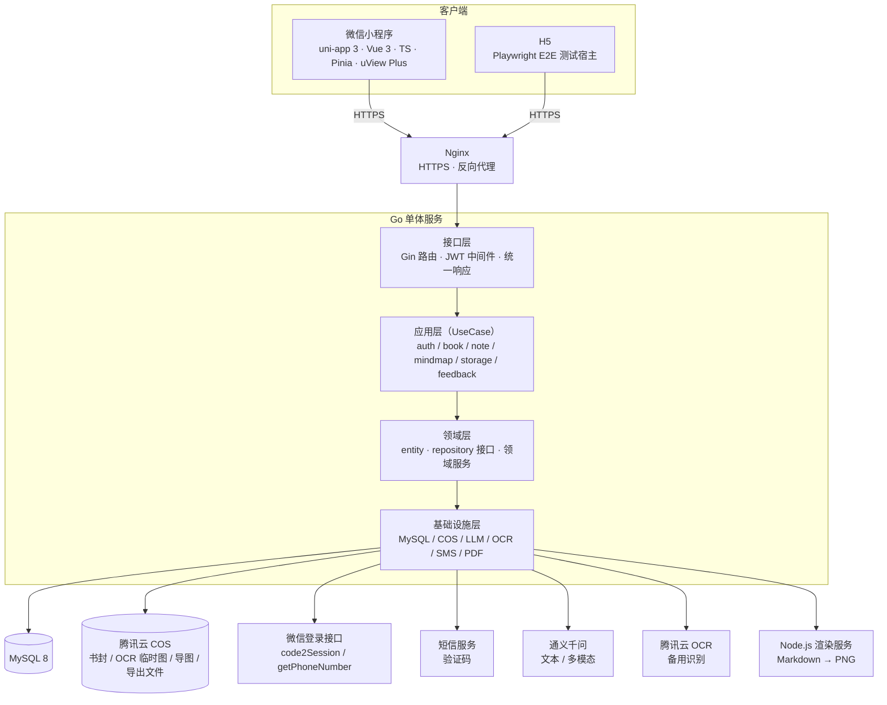
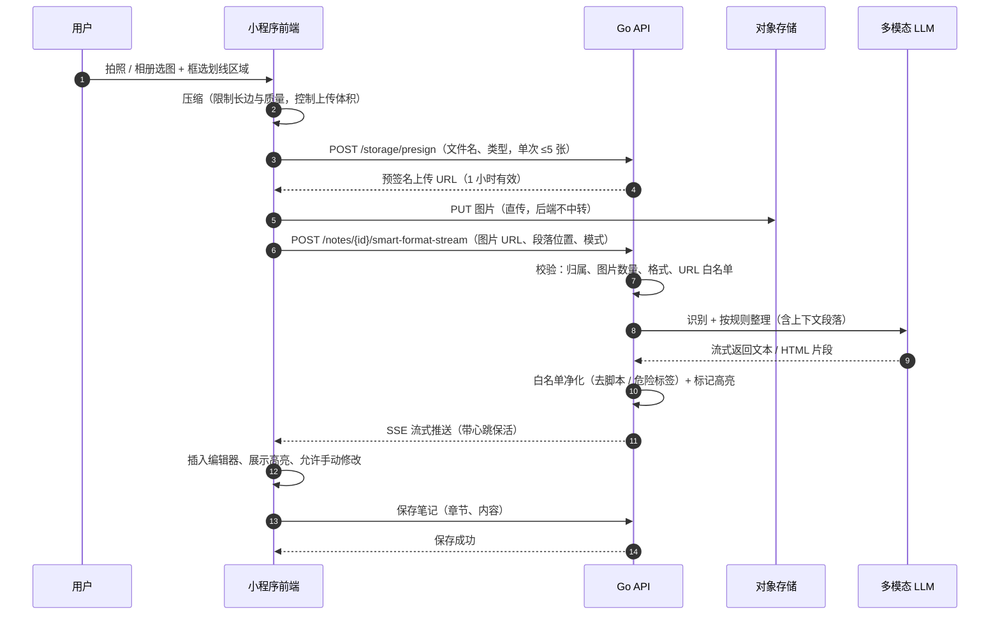
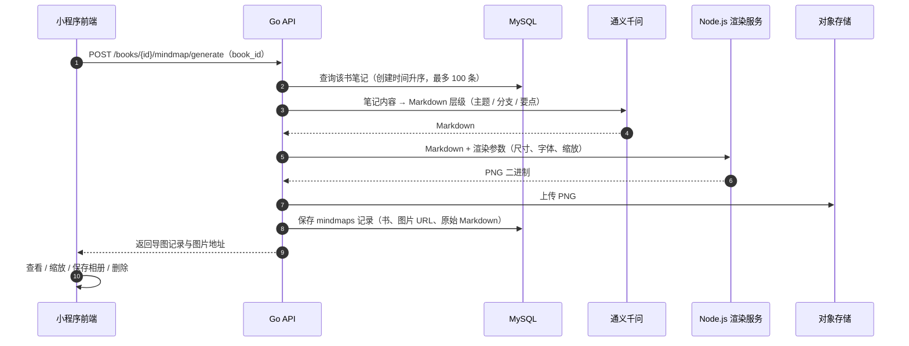
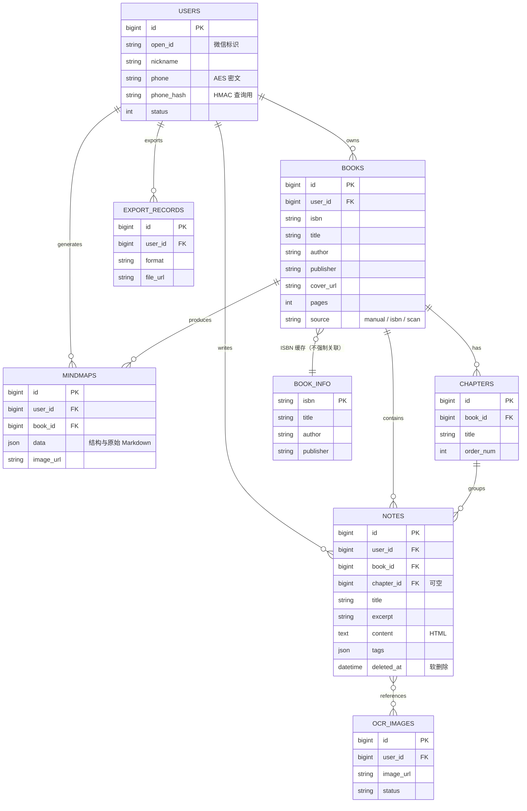

# 03 · 技术架构：一个人维护的系统怎么搭

> 本文说明阅记的前后端架构、两条 AI 链路（OCR 整理 / 思维导图）、数据模型与关键取舍。所有图用 Mermaid 绘制，GitHub 原生渲染。
>
> 一张可单独打开的矢量总览图：[assets/diagrams/system-overview.svg](../assets/diagrams/system-overview.svg)。
>
> 架构设计的核心约束是"**一个人维护**"：所有选择都优先考虑部署简单、可调试、故障可解释，而不是性能上限与扩展性。

---

## 1. 架构目标与约束

| 约束 | 具体表现 | 对架构的影响 |
|---|---|---|
| 单人维护 | 产品、前端、后端、测试、上线都是一个人 | 单体优先、少中间件、单机可运行 |
| 成本敏感 | OCR / LLM 按调用计费 | 免费能力优先，识别与整理合并成一次调用 |
| 快速上线 | 从立项到上线半年多，中间还返工过两次架构 | 不做微服务、不做消息队列、不做多端同步 |
| 移动端为主 | 微信小程序是唯一正式渠道 | 前端以 uni-app 为主，H5 只做测试宿主 |
| AI 输出不稳定 | LLM 会返回不规范内容 | 全链路做校验、净化、降级与兜底 |

---

## 2. 系统上下文



**为什么是单体**：MVP 的瓶颈不在吞吐，而在"我能否在一周内改完一个需求并验证"。单体 + 四层划分已经能把业务、接口、外部依赖分开，未来要拆也拆得动；现在拆只会增加部署与调试成本。

---

## 3. 分层结构

后端按 Clean Architecture 的简化版分层（目录名即职责）：

```
cmd/api/                     # 程序入口：配置加载、依赖装配、路由注册
internal/
├── interfaces/              # 接口层
│   ├── api/v1/              # HTTP Handler（auth / book / note / mindmap / storage / chapter / feedback）
│   └── middleware/          # JWT 鉴权、CORS、请求日志、错误恢复
├── application/             # 应用层
│   ├── usecase/             # 业务流程编排（一个模块一个 UseCase）
│   ├── dto/                 # 请求 / 响应结构
│   └── strategy/            # OCR 等可切换策略
├── domain/                  # 领域层
│   ├── entity/              # 业务实体
│   ├── repository/          # 仓储接口（不含 SQL）
│   └── service/             # 领域服务接口（AI、OCR、PDF）
├── infrastructure/          # 基础设施层
│   ├── persistence/mysql/   # GORM 模型、仓储实现、迁移
│   ├── external/            # COS / 微信 / OCR / PDF / 渲染服务客户端
│   ├── llm/                 # 大模型适配器（工厂 + 供应商实现）
│   ├── sms/                 # 短信服务与限流
│   └── config/              # 配置加载
└── pkg/                     # 通用包：错误码、统一响应、日志、加密
```

分层的实际收益是**可替换**：OCR 从"微信插件"换成"多模态 LLM"时，只改了策略与 UseCase 编排，Handler 与前端接口协议基本没动；模型供应商在适配器层用工厂切换（通义千问 / 其它兼容 OpenAI 协议的服务）。

---

## 4. 链路 A：照片 → 结构化笔记

这是整个产品最复杂的链路，经历了两代方案。

### 4.1 两代方案与取舍

| | 第一代（端内 OCR） | 第二代（直传 + 多模态 LLM） |
|---|---|---|
| 识别位置 | 前端调用微信 OCR 插件 | 服务端调用多模态模型 |
| 图片是否出端 | 否 | 是（上传到对象存储临时目录） |
| 优点 | 免费、快、隐私口径好 | 识别 + 理解 + 结构化一次完成，精度更好 |
| 缺点 | 精度有限、切行分段差、依赖平台插件、无法多端 | 有调用成本、等待更久、需要隐私口径调整、输出需要净化 |
| 结论 | 作为过渡方案；"图片不出端"的优势保留，但精度与结构化不足 | **作为主链路**；腾讯云 OCR 留作备用降级 |

### 4.2 主链路时序



### 4.3 关键设计点

- **为什么用预签名 URL 直传**：图片走前端直传，后端不接收大文件、不占内存、不占带宽；代价是需要处理临时文件的清理与访问权限。上传路径按用户与时间分目录，避免覆盖与越权。
- **为什么用 SSE 而不是轮询**：一次整理可能持续数秒到十几秒，轮询会产生大量无效请求且体验断裂；SSE 可以边生成边展示，并用心跳避免网关把长连接判死。代价是前端要处理流式解析、超时与断线重连。
- **上下文怎么给**：整理某段划线时，把该段**前 2 段 + 后 1 段**作为上下文一起送给模型，让模型能补全语义断裂的句子，而不是孤立地识别一行字。
- **输出怎么控**：模型返回的 HTML 必须过白名单净化（只保留段落、列表、加粗等安全标签），再把识别的划线内容转成高亮样式；**永远不直接信任模型输出**。
- **失败怎么办**：识别失败 / 超时 / 模型返回不合规时，提示用户重试或转手动输入；不覆盖用户已有内容。

---

## 5. 链路 B：笔记 → 思维导图



**为什么用「Markdown + 渲染服务」而不是原生导图库**：原生导图库（如 XMind 类）适合编辑，但小程序端渲染与导出图片都很重；用模型输出 Markdown 层级，再用服务端 HTML → PNG 渲染，实现成本最低，也天然拿到了可编辑的中间产物（Markdown）。**代价**是多了一个 Node.js 运行时，且渲染依赖外部资源与浏览器内核，曾出现超时与资源加载失败——后期通过把外部 CDN 依赖本地化、升级渲染库、调大超时配置缓解，但没有做到 100% 稳定。

---

## 6. 链路 C：导出

- **支持格式**：单条笔记 → PDF / Word（docx）/ Markdown（早期曾实现并测试过书籍汇总导出接口，最终交付里没有保留）；
- **流程**：服务端生成文件 → 上传 COS → 返回带过期时间的预签名下载地址 → 前端下载 / 分享；
- **取舍**：PDF 需要处理中文字体嵌入（字体文件不随本仓库分发），排版用固定模板而不是所见即所得编辑器——保证"导出的东西可打印"，但牺牲了自定义排版能力；
- **实测**：单条笔记 PDF 生成约 0.75s（接口级测试记录，不含下载）。

---

## 7. 数据模型



**几个数据层的决策**：

- **笔记软删除**：`notes.deleted_at` 不为空即视为删除，查询默认过滤——用户误删可恢复，代价是查询永远要带过滤条件、数据只增不减；
- **书籍删除采用"前置校验 + 物理删除"**：有笔记或导图时不允许删书，提示先清理。ADR 里最初计划书籍也做软删除（迁移里甚至加过 `deleted_at` 字段），落地时改成了这个更简单的规则——**决策与实现脱节，是这类个人项目里最真实的坑**；
- **章节用 `GetOrCreate`**：保存笔记时按"书 + 章节名"自动建章节，避免用户先维护目录再写笔记；
- **手机号加密存两列**：密文（AES-256 + Base64，随机 IV）用于展示与导出，HMAC 哈希用于登录查询——加密字段不能直接查，这是加密的必付代价。

---

## 8. API 设计

统一约定：RESTful 风格；`/api/v1` 前缀；受保护接口全部过 JWT 中间件；响应统一 `{ code, message, data }`；错误码分业务错误与系统错误，对外不暴露底层堆栈。

| 分组 | 代表接口 | 说明 |
|---|---|---|
| 认证 | `POST /auth/wechat/quick-login`、`POST /auth/code/sms`、`POST /auth/phone/login`、`GET /users/profile`、`POST /auth/logout` | 微信一键登录为主，短信验证码登录降级；JWT 7 天 |
| 书籍 | `GET/POST/PUT/DELETE /books`、`GET /books/search`、`POST /books/batch-delete`、`GET /books/isbn/:isbn`、`GET /books/{id}/chapters` | 含 ISBN 查询与章节列表；删除前校验关联数据 |
| 笔记 | `GET/POST/PUT/DELETE /notes`、`DELETE /notes/batch`、`POST /notes/{id}/smart-format-stream`、`POST /notes/{id}/export` | 编辑保存、AI 整理（SSE）、导出 |
| 思维导图 | `POST /books/{id}/mindmap/generate`、`GET /books/{id}/mindmap`、`GET /mindmaps`、`DELETE /books/{id}/mindmap` | 按书生成、查看、删除 |
| 存储 | `POST /storage/presign`、`POST /storage/cover/presign`、`DELETE /storage/temp` | 预签名直传与临时文件清理 |
| 反馈 | `POST /feedbacks` | 内测期的用户反馈入口（联系方式加密存储） |

**接口层面的两个细节**：

1. **流式接口的协议**：`smart-format-stream` 用 SSE，返回事件里区分"心跳 / 内容增量 / 错误 / 结束"，前端按事件类型解析——这样长请求在网关层不会被误判为超时；
2. **上传接口只发签名不算权限**：预签名 URL 有时效与目录隔离，服务端在"生成整理任务"时还会再校验一次图片 URL 是否属于当前用户，避免拿到别人的图片地址就能处理。

---

## 9. 安全与隐私（实际做到 vs 没做到）

| 项 | 状态 | 说明 |
|---|---|---|
| 传输加密 | ✅ | 全站 HTTPS |
| 鉴权 | ✅ | JWT（7 天）+ 中间件统一校验；受保护接口不允许绕过 |
| 数据隔离 | ✅（主体） | 书籍 / 笔记 / 导图接口按 `user_id` 校验归属；个别辅助接口的校验项当时仍有 TODO，未逐项闭环 |
| 敏感字段加密 | ✅ | 手机号、反馈联系方式 AES 加密存储 + HMAC 索引 |
| 日志脱敏 | ✅ | 手机号、token 等敏感信息在日志中打码 |
| 对象存储权限 | ✅ | 预签名 URL 直传，密钥不下发前端；临时目录可清理 |
| 输入校验 | ✅ | 参数绑定 + 必填 / 格式 / 长度校验；文件类型与大小白名单 |
| 端到端加密 | ❌ **未实现** | 服务端可解密笔记内容；不要把它写进产品承诺 |
| 审计日志 | ⚠️ 部分 | 有结构化请求日志与错误日志，没有独立审计流水 |
| 监控告警 | ❌ 未做 | 没有 APM / 指标看板 / 告警，内测期靠人工看日志 |

---

## 10. 已知问题与技术债（当时未解决）

1. **书籍删除语义不统一**：ADR 计划软删除，实现是"有笔记/导图则拒删 + 物理删除"；
2. **缓存层缺失**：MVP 不做业务缓存（短信验证码限流是唯一用到 Redis 的地方），高并发时需要补；
3. **章节自动解析未完成**：目录 / 页边章节的自动识别没做，章节靠用户选择与手动确认；
4. **渲染链路稳定性**：思维导图依赖 Node.js 渲染与浏览器内核，偶发超时；
5. **多端只落地一端**：uni-app 的 App 端只有配置，没有开发；
6. **无监控与埋点**：内测期无法回答"次日留存是多少"这类问题；
7. **App 端停在半路**：后期做过 App 端登录适配的零星开发，但 App 本身没有发布。
